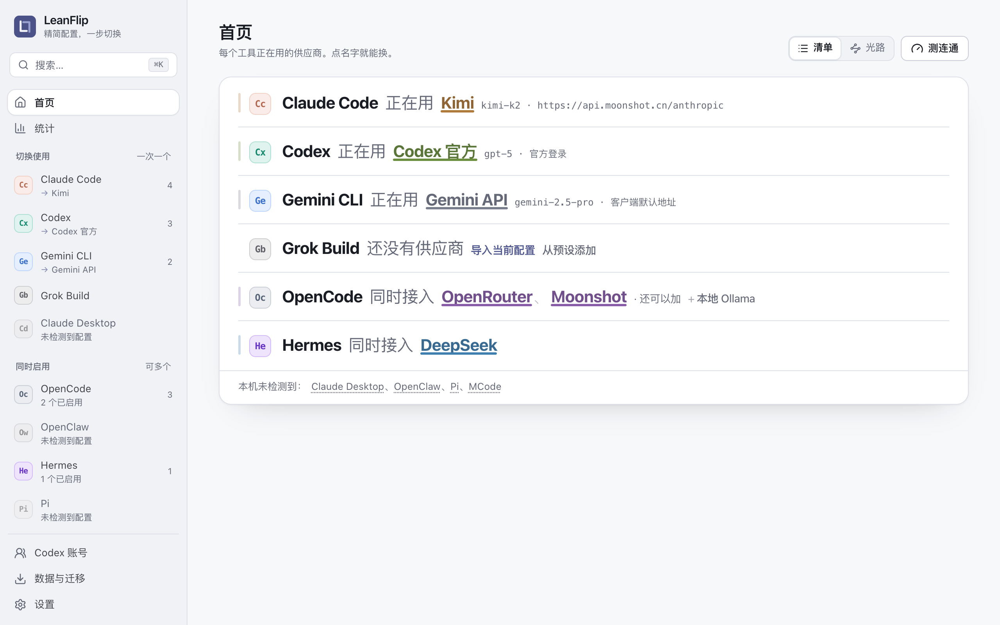
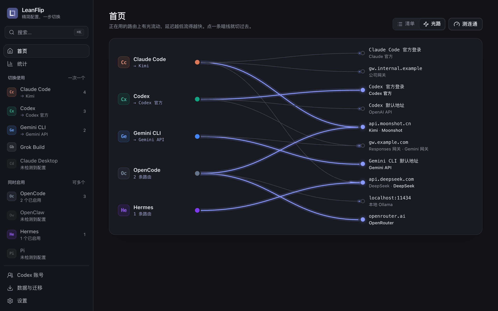
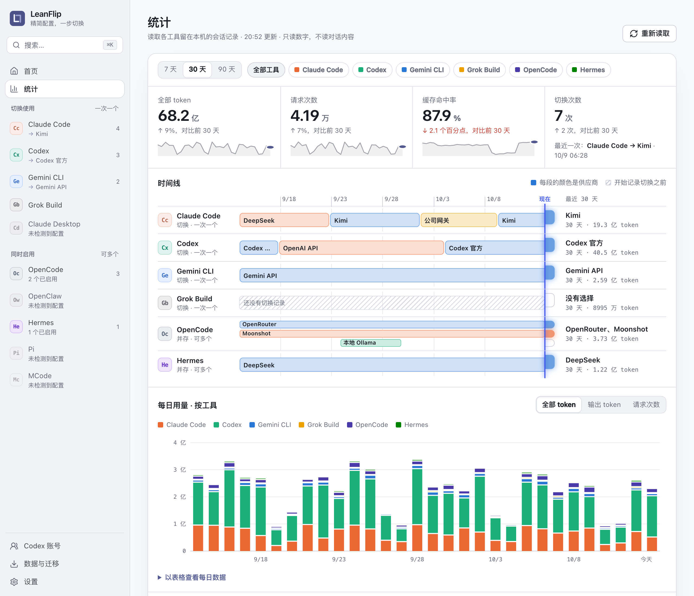

<div align="center">


# LeanFlip · 简切

**一份配置库，桌面 App、命令行和全屏 TUI 三种用法。**

在本地管理 Claude Code、Codex、Gemini CLI 等 AI 编程工具的供应商，一键切换，不代理任何请求。

[](https://github.com/Ricardo121380/LeanFlip/releases/latest)
[](https://www.npmjs.com/package/leanflip)
[](https://github.com/Ricardo121380/LeanFlip/releases)
[](https://github.com/Ricardo121380/LeanFlip/actions/workflows/ci.yml)
[](LICENSE)
[](https://linux.do)

[**安装**](#安装) · [**快速上手**](#快速上手) · [使用手册](docs/guide.md) · [CLI 说明](crates/cli/README.md) · [更新日志](docs/releases) · [反馈问题](https://github.com/Ricardo121380/LeanFlip/issues)

</div>

> [!NOTE]
> **🤝 LINUX DO 开源推广声明**
>
> 本项目积极参与并认可 [LINUX DO 社区](https://linux.do)，遵循社区「开源推广」规范：项目完整开源，没有未开源的部分。欢迎佬友试用、提 Issue 或 PR。



## 简介

LeanFlip 把各家供应商的地址、密钥和模型存成一张张“卡片”，切换时写进 AI 工具实际读取的配置文件。桌面 App、交互菜单和 TUI 共用 `~/.leanflip/` 里的同一份数据：在 App 里添加，在终端里用方向键切换。

> [!IMPORTANT]
> LeanFlip 只管理配置，**不做本地代理、请求转发或负载均衡**。使用前需要自行安装对应的 AI 工具，并准备它支持的账号或 API Key。

## 亮点

| 特性 | 说明 |
| --- | --- |
| 💬 **一句话切换** | 首页写着“Claude Code 正在用 Kimi”，点供应商名就能换；光路视图画出每个工具正在走哪条路由 |
| 🧰 **10 种工具** | 切换式与并存式工具都支持，见[下表](#支持的工具) |
| 📊 **额度与用量** | Codex 官方限额、sub2api / NewAPI 中转余额、Krill 账户套餐，以及按天汇总的 token 用量 |
| 👥 **Codex 多账号** | 托管多个 ChatGPT 登录，每张卡片可以绑定不同账号 |
| 🔐 **加密备份** | `.leanflip` 备份用 age 密码加密，三端通用，可按工具、账号、设置选择恢复 |
| 🚚 **从 CC Switch 迁移** | 只读导入本机数据目录或导出文件，不改动原数据 |

<table>
<tr>
<td width="50%"><p align="center"><sub>光路：工具到服务端点的路由</sub></p></td>
<td width="50%"><p align="center"><sub>统计：按供应商着色的每日用量</sub></p></td>
</tr>
</table>

## 支持的工具

| 切换式 · 同时只用一个 | 并存式 · 可同时启用多个 |
| --- | --- |
| Claude Code · Codex · Gemini CLI · Grok Build · Claude Desktop | OpenCode · OpenClaw · Hermes · Pi · MCode |

切换式工具用 `leanflip use` 切换；并存式工具用 `leanflip enable` / `disable` 写入或移出客户端配置。

## 安装

支持 **Windows 10 / 11 x64**、**macOS Apple Silicon** 和 **Linux x86_64**。

**Homebrew**（macOS 推荐）

```sh
brew tap ricardo121380/leanflip https://github.com/Ricardo121380/LeanFlip.git
brew install --cask ricardo121380/leanflip/leanflip-app   # 桌面 App
brew install --cask ricardo121380/leanflip/leanflip       # 命令行与 TUI
```

**npm**（Node.js 20+）

```sh
npm install -g leanflip
leanflip-app install   # 可选：同时安装桌面 App
```

**安装包**：在 [Releases](https://github.com/Ricardo121380/LeanFlip/releases/latest) 下载。

| 平台 | 桌面 App | 命令行与 TUI |
| --- | --- | --- |
| Windows 10 / 11 x64 | `windows-x64-setup.exe` | `windows-x64.zip` |
| macOS Apple Silicon | `.dmg` | `macos-arm64.tar.gz` |
| Linux x86_64 | `.deb`（Ubuntu 24.04 构建） | `linux-x64.tar.gz` |

> [!WARNING]
> App 和命令行暂未使用 Apple Developer ID 签名与公证，macOS 首次运行会被拦下：App 到“系统设置 → 隐私与安全性”点“仍要打开”；命令行执行 `xattr -d com.apple.quarantine leanflip`。

Windows 安装程序支持中文和英文，默认安装到当前用户目录，缺少 WebView2 时会联网安装运行时。安装包暂未代码签名，首次运行可能出现 SmartScreen 提示；请核对 Release 的 `SHA256SUMS`。CLI 解压后在 PowerShell 中运行 `./leanflip.exe`，无需桌面 App。

Windows CLI / TUI（包括 npm 启动的原生 CLI）需要 [Microsoft Visual C++ v14 x64 运行库](https://learn.microsoft.com/en-us/cpp/windows/latest-supported-vc-redist)。若提示缺少 `VCRUNTIME140.dll`，安装该页面的 X64 版本后重试。

源码构建、校验下载与升级卸载见[使用手册 · 安装](docs/guide.md#安装)。

## 快速上手

**桌面 App**

1. 左侧选择工具，确认页面顶部的配置文件路径就是你在用的那个。
2. 点 **导入当前配置**，把现有配置存成第一张卡片。
3. 点 **添加供应商**，从预设开始填写地址、Key 和模型，可以先“测连通”“检查模型”。
4. 点 **切换**（并存式工具打开开关），回到 AI 工具里开个新会话。

按 `⌘K`（Windows / Linux 为 `Ctrl+K`）可以在任意页面搜索并切换供应商。

**命令行**

```sh
leanflip                          # 交互菜单：方向键选择，回车执行
leanflip tui                      # 全屏 TUI 工作台
leanflip status                   # 所有工具的当前状态
leanflip list codex               # 查看供应商及 ID
leanflip use codex PROVIDER_ID    # 切换
leanflip import live codex        # 导入当前客户端配置
```

加 `--json` 可用于脚本，`--lang en` 切换到英文输出。

## 文档

| 主题 | 内容 |
| --- | --- |
| [第一次使用](docs/guide.md#第一次使用) | 接管现有配置，或从零添加供应商 |
| [桌面 App](docs/guide.md#桌面-app-使用指南) | 首页、额度、统计、编辑器、命令面板、设置与托盘 |
| [命令行与 TUI](docs/guide.md#cli-使用指南) | 快捷键、常用命令、JSON 输出与退出码 |
| [从 CC Switch 迁移](docs/guide.md#从-cc-switch-迁移) | 本机数据目录与导出文件的导入规则 |
| [加密备份与恢复](docs/guide.md#加密完整备份与恢复) | 备份范围、恢复选项、脚本用法 |
| [Codex 登录与多账号](docs/guide.md#codex-登录与多账号) | 本机登录保留、托管账号、令牌刷新 |
| [配置目录与数据](docs/guide.md#配置目录与数据备份) | 各工具配置路径、LeanFlip 数据文件、中断恢复 |
| [常见问题](docs/guide.md#常见问题) | 命令找不到、导入后没切换、写入冲突等 |
| [升级与卸载](docs/guide.md#升级与卸载) | 各安装方式的升级、卸载及 0.1.x 迁移 |

## 隐私与安全

- **不经手请求**：AI 工具直接连接供应商，LeanFlip 只负责写配置。
- **用量只读本机**：统计只读取各工具会话记录里的时间、模型和 token 数，不读对话内容，不上传。
- **联网可预期**：测连通不发送密钥；获取模型列表、检查模型和中转额度查询会带上该卡片的 Key，只发往它自己的地址，不跟随重定向。额度自动刷新默认关闭，托管账号的后台刷新可在设置中关闭。
- **写入有保护**：Unix 凭据文件权限收紧到 `0600`，Windows 使用所在用户目录的访问权限，每个文件首次写入前自动备份，写到一半中断可以恢复。

> [!CAUTION]
> `~/.leanflip/` 中保存着 API Key 和登录凭据，它不是加密保险箱。分享截图、日志或提交 Issue 前请移除敏感内容。

## 开发

```sh
pnpm install --frozen-lockfile --ignore-scripts
pnpm dev:mock                     # 用演示数据在浏览器中打开界面，不读写真实配置
pnpm typecheck && pnpm test
cargo test --workspace --locked
```

> [!WARNING]
> `pnpm tauri dev` 会读写当前用户的真实配置，调试真实 App 请先按[开发说明](docs/guide.md#开发)准备临时目录。

项目结构、CI 与发布流程见[使用手册 · 开发](docs/guide.md#开发)和[分发维护说明](docs/distribution.md)。

## 致谢

- [LINUX DO](https://linux.do)：新一代开源技术社区。LeanFlip 积极参与并认可 LINUX DO 社区，感谢佬友们的试用、反馈与建议。
- 所有提交 Issue、PR 和使用反馈的朋友。

## 许可证

[MIT License](LICENSE)。实现依据与兼容边界见[独立实现记录](docs/engineering/independent-core.md)和[兼容说明](docs/engineering/compatibility.md)；第三方依赖适用各自的许可证。

## Star History

<a href="https://www.star-history.com/#Ricardo121380/LeanFlip&Date">
  <picture>
    <source media="(prefers-color-scheme: dark)" srcset="https://api.star-history.com/svg?repos=ricardo121380/leanflip&type=Date&theme=dark" />
    <source media="(prefers-color-scheme: light)" srcset="https://api.star-history.com/svg?repos=ricardo121380/leanflip&type=Date" />
    
  </picture>
</a>

<div align="center">

如果 LeanFlip 帮到了你，欢迎点一个 ⭐ Star。

[回到顶部 ↑](#leanflip--简切)

</div>
